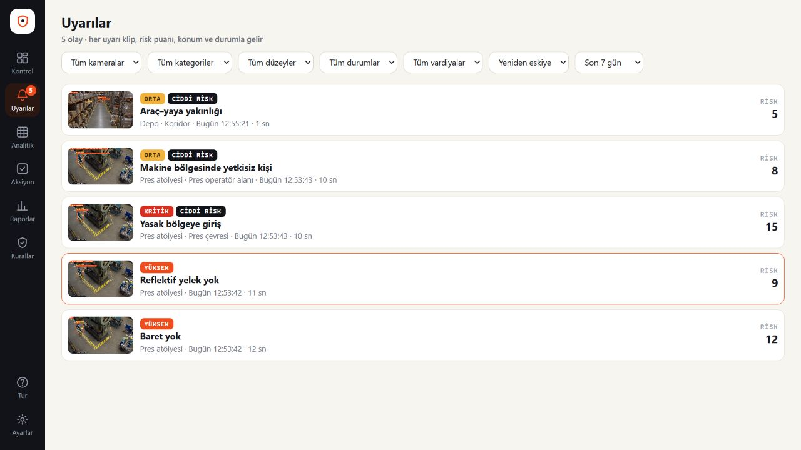
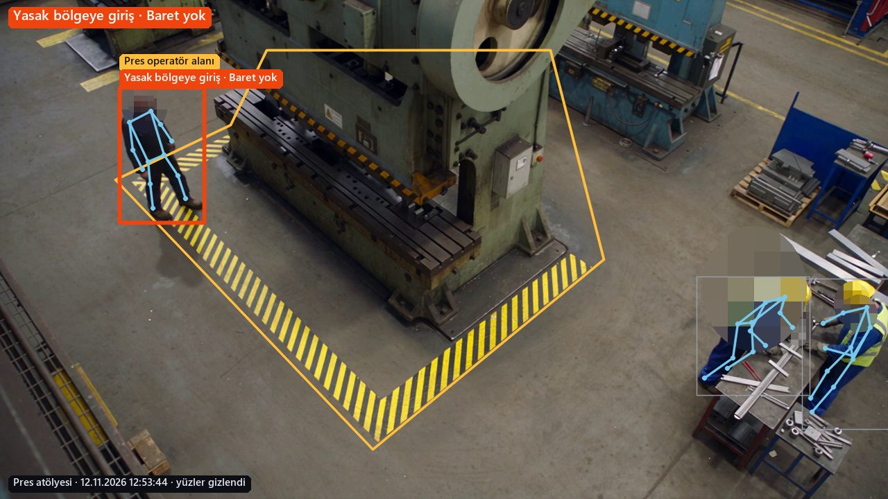

# İSG Kamera

İSG Kamera helps you inspect workplace health and safety conditions in security camera feeds and video recordings. It detects events such as missing helmets or vests, entry into restricted areas and vehicle–pedestrian proximity, and brings alerts and event clips together in a dashboard.

The application interface and installer are currently in Turkish.

<p align="center">
  <a href="https://github.com/lyunusl/isg-kamera/releases/latest/download/IsgKamera-Kurulum-0.1.0.exe">
    
  </a>
  <br>
  <sub>Windows 10/11 (64-bit) · <a href="https://github.com/lyunusl/isg-kamera/releases/latest">Release notes</a></sub>
</p>


*The control room displays data generated by sample video analysis.*

## What can you do?

- **Add a camera or video.** Use an IP camera, recorder, ONVIF device, HTTP stream or video file.
- **Draw monitoring zones.** Mark areas such as machine surroundings, restricted areas and vehicle routes on the image.
- **Select rules.** Configure the protective equipment, area, behaviour and vehicle rules to monitor for each camera.
- **Review alerts.** Filter events by risk level, camera and status. Open the event frame and its clip when available.
- **Follow up and report.** Create actions from alerts, review visual analytics and export Excel reports.
- **Configure outputs.** Send event information through Modbus TCP, OPC UA, MQTT, webhooks and email.



*Alerts from sample videos are listed with camera and risk information.*

## What does it detect?

| Category | Examples |
|---|---|
| Protective equipment | Missing helmets, reflective vests, gloves and safety glasses |
| Area monitoring | Restricted-area entry, unauthorised people in a machine area, too many or too few people in an area |
| Vehicles | Vehicle–pedestrian proximity, driving in the wrong direction and obstacles in vehicle paths |
| Behaviour and ergonomics | Running, climbing, fallen people and approximate posture assessment |


*The rules screen shows each rule's description and test status.*



*A marked zone and detected event in an AI-generated sample video.*

## How it works

1. Add a camera stream or video file.
2. Draw zones on the image and select the rules to monitor.
3. Start analysis. **AugeLab Studio** processes the images in the background on your computer, without opening its window.
4. Review alerts, images and reports in the İSG Kamera dashboard.

The application includes four sample videos and prepared camera settings. Run the samples to explore the dashboard.

## Installation

Download and run the installer using the **Download for Windows** button above. The installer guides you through these steps.

1. **İSG Kamera** is installed for the current user without administrator permission.
2. If **AugeLab Studio** is missing, its official installer is downloaded, verified and installed silently. If the Visual C++ component is missing, it is installed from Microsoft. Windows may request permission.
3. **AugeLab account:** create an account in your browser if you do not already have one. The free Community plan is sufficient.
4. **Licence code:** paste the code from your account. It is registered with Studio without opening the Studio window. İSG Kamera does not store the code.

After installation, İSG Kamera opens its dashboard in your browser. A short background check verifies that Studio is ready. If you skip a step, the dashboard's setup wizard shows it again. Then run sample analysis from **Settings** or add a camera.

Analysis requires an AugeLab Studio licence that permits headless use. Studio validates the licence during analysis. Internet access is required for initial installation and activation. Studio applies your licence's FPS limit.

## Cameras and data

ONVIF devices can be discovered on the network, and recorder channels can be added as separate cameras. RTSP addresses can also be entered manually. Passwords are not stored in the settings file.

Analysis runs on your computer. **Faces of detected people are obscured** in event frames and clips. Face obscuring depends on person detection, so an undetected person's face may remain visible. Event records are stored locally, and event information can be sent to configured notification outputs.

## Limitations and test status

- This release is under development. Sample clips were generated with AI and have not been validated against real camera recordings.
- End-to-end testing with a real IP camera, ONVIF device and recorder has not been completed. The ONVIF flow was tested with a local test device.
- The machine sample was processed successfully in an installed Studio. The Studio scene stopped early in the warehouse sample. Analysis of the other samples and the latest release in a clean Windows environment remains unverified.
- Some rules have limited results. Details for rules such as safety harnesses and hearing protection appear in the dashboard. The RULA rule is not yet active.
- One camera is monitored at a time. USB cameras are not supported in this release. Use an IP camera, recorder or video file.
- Siemens S7 output is not available in this release. The dashboard sends Modbus TCP, MQTT, OPC UA, webhook and email outputs.
- Notification and control outputs are intended for alerts and integration. They are not safety stop systems.

## Development from source

Prepare the environment in the project directory on Windows x64 with Python 3.12.

```powershell
py -3.12 -m venv .venv
.venv\Scripts\python -m pip install -r requirements.txt
.venv\Scripts\python -m pip install --target motor\deps --no-deps onnxruntime==1.31.1
New-Item -ItemType Directory -Force motor\modeller | Out-Null
Copy-Item kurulum\community-modeller\* motor\modeller\
.venv\Scripts\python uygulama.py
```

The dashboard opens at `http://127.0.0.1:8780`. AugeLab Studio must be installed and licensed. The dashboard runs it in the background with `python -m studio run` for each camera.

The prepared scene (`kurulum\sahne\isg-kamera.pmod`) is not included in the repository because Studio saves scene files in encrypted form and saving must be performed in the Studio window. Create it once as follows.

1. Open Studio with MCP enabled at `127.0.0.1:8765`.
2. Run `.venv\Scripts\python kurulum\sablon.py`.
3. In Studio, use **File → Save As** to save the opened tab to `kurulum\sahne\isg-kamera.pmod`.

To build the EXE and Windows installer, run `kurulum\derle.cmd` with PyInstaller and Inno Setup.

## Licences and sources

İSG Kamera's code is licensed under GNU AGPL-3.0. AugeLab Studio is a separately licensed product. [Application licence](LICENSE) · [Windows package notices](ATIFLAR.md) · [Model licence notices](MODEL-LISANSLARI.md)
