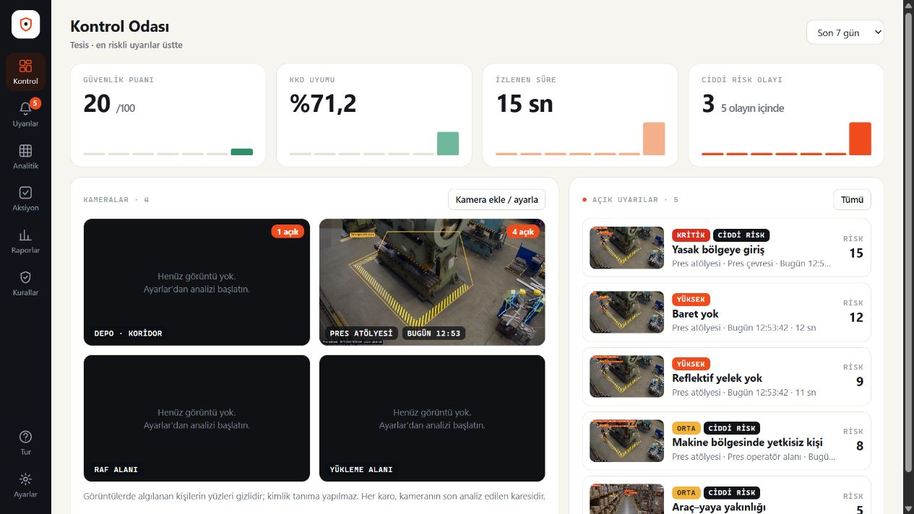
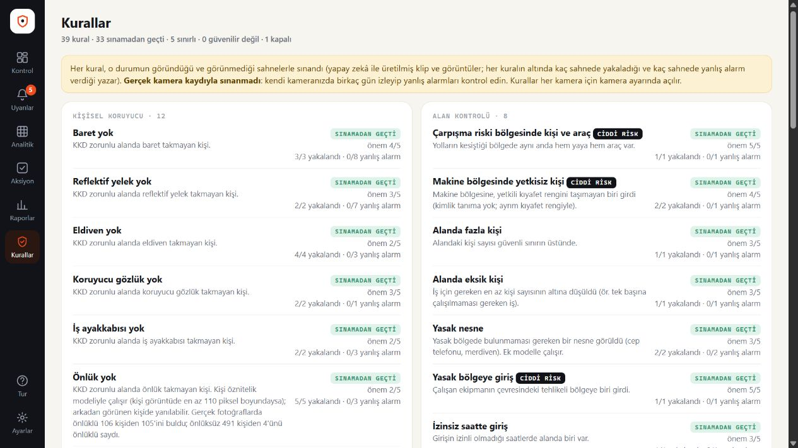

[Türkçe](docs/README.tr.md)

# İSG Kamera

İSG Kamera helps you review occupational health and safety situations in security camera feeds and video recordings (İSG is the Turkish abbreviation for occupational health and safety). It detects events such as a missing hard hat or vest, entry into a restricted zone and vehicle–pedestrian proximity, and brings alerts and event clips together in a dashboard.

The panel and the installer are available in English and Turkish. The installer asks for the language, and you can switch it at any time in the panel.

<p align="center">
  <a href="https://github.com/lyunusl/isg-kamera/releases/latest/download/IsgKamera-Kurulum-0.1.0.exe">
    
  </a>
  <br>
  <sub>Windows 10/11 (64-bit) · <a href="https://github.com/lyunusl/isg-kamera/releases/latest">Release notes</a></sub>
</p>



*The Control Room showing data produced by a sample video analysis.*

## What you can do

- **Add cameras or videos.** Work with an IP camera, a recorder (NVR), an ONVIF device, an HTTP stream or a video file.
- **Draw the zones to watch.** Mark areas such as a machine's surroundings, a restricted zone or a vehicle lane on the image.
- **Choose the rules.** For each camera, set the protective equipment, zone, behavior and vehicle rules you want to monitor.
- **Review alerts.** Filter events by risk level, camera and status. Open the event's snapshot and, when one was recorded, its clip.
- **Follow up and report.** Create actions from alerts, review the visual analytics and export an Excel report.
- **Configure outputs.** Send event information through integrations such as Modbus TCP, OPC UA, MQTT, webhooks and email.


*Alerts from the sample videos are listed with camera and risk information.*

## What it detects

| Category | Examples |
|---|---|
| Protective equipment | Missing hard hat, hi-vis vest, gloves or safety glasses |
| Zone control | Entry into a restricted zone, unauthorized person in a machine zone, too many or too few people in a zone |
| Vehicles | Vehicle–pedestrian proximity, wrong-way driving and obstacles in the vehicle lane |
| Behavior and ergonomics | Running, climbing, person down and an approximate posture assessment |



*The Rules screen shows each rule's description and test status.*


*A marked zone and a detected event in an AI-generated sample video.*

## How it works

1. Add a camera stream or a video file.
2. Draw zones on the image and choose the rules to monitor.
3. Start the analysis. **AugeLab Studio** on your computer processes the video in the background; the Studio window does not open.
4. Review the resulting alerts, images and reports in the İSG Kamera panel.

The application includes four sample videos and prepared camera settings. Run the samples first to explore the panel.

## Installation

Download and run the installer with the **Download for Windows** button above. The installer guides you through these steps:

1. **İSG Kamera** is installed for the current user (no administrator rights needed).
2. **AugeLab Studio**: if it is not installed, the official installer is downloaded, verified and installed silently. If the Visual C++ component is missing, it is installed from Microsoft; Windows may ask for permission.
3. **AugeLab account**: if you do not have an account, create one in your browser with the button. The free Community plan is enough.
4. **License code**: paste the license code from your account. The code is registered with Studio without opening the Studio window; İSG Kamera does not store it.

When installation finishes, İSG Kamera starts and the panel opens in your browser. A short background test confirms that Studio is ready. If you skipped a step, the setup wizard in the panel shows the same steps. Then run the sample analysis or add a camera from **Settings**.

You can run the analysis with an AugeLab Studio license that allows headless use. Studio checks the license during the analysis. An internet connection is needed for the first installation and for license activation. Studio applies your license's FPS limit.

## Cameras and data

ONVIF devices can be discovered on the network, and the channels of a recorder can be added as separate cameras. You can also enter an RTSP address by hand. Passwords are not saved in the settings file.

Analysis runs on your computer. In event snapshots and clips, **the faces of detected people are masked**. Face masking depends on person detection; the face of a person who is not detected can stay visible. Event records are stored on the computer, and event information can be sent to the notification outputs you configure.

## Limitations and test status

- This release is at the development stage. The sample clips were generated with AI and have not been validated on real camera recordings.
- No end-to-end test has been done with a real IP camera, ONVIF device or recorder. The ONVIF stream was tested with a local test device.
- The machine sample was processed successfully in an installed Studio. In the warehouse sample, the Studio scene stopped early. Analysis of the other samples with the latest release, and on a clean Windows installation, is still to be verified.
- Some rules give limited results; details for rules such as safety harness and hearing protection are shown in the panel. The RULA rule is not active yet.
- One camera is monitored at a time. USB cameras are not supported in this release; use an IP camera, a recorder or a video file.
- There is no Siemens S7 output in this release. The panel sends the Modbus TCP, MQTT, OPC UA, webhook and email outputs.
- Notification and control outputs are meant for warnings and integration. They must not be used as a safety stop.

## Development from source

Prepare the environment in the project folder on Windows x64 with Python 3.12.

```powershell
py -3.12 -m venv .venv
.venv\Scripts\python -m pip install -r requirements.txt
.venv\Scripts\python -m pip install --target engine\deps --no-deps onnxruntime==1.31.1
New-Item -ItemType Directory -Force engine\models | Out-Null
Copy-Item installer\community-models\* engine\models\
.venv\Scripts\python app.py
```

The panel opens at `http://127.0.0.1:8780`. AugeLab Studio must be installed and licensed; the panel does not open Studio, it runs it in the background with `python -m studio run` for each camera.

The ready-made scene that is run (`installer\scene\isg-kamera.pmod`) is not in the repository, because Studio saves scene files encrypted and saving is only possible from the Studio window. It is produced once:

1. Open Studio. MCP must be available at `127.0.0.1:8765`.
2. Run `.venv\Scripts\python installer\build_scene.py`.
3. In Studio, save the tab that opens with **File → Save As** as `installer\scene\isg-kamera.pmod`.

To build the EXE and the Windows installer, run `installer\build.cmd` with PyInstaller and Inno Setup.

## License and sources

The İSG Kamera code is licensed under GNU AGPL-3.0. AugeLab Studio is a separately licensed product. [Application license](LICENSE) · [Windows package attributions](ATTRIBUTIONS.md) · [Model license notices](MODEL-LICENSES.md)
